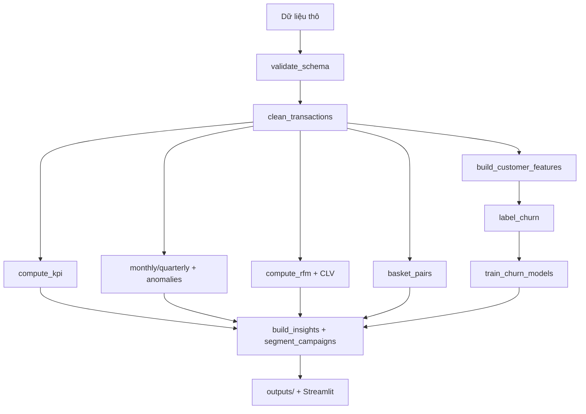

# ARCHITECTURE — Retail Analytics Intelligence

## Nguyên tắc
- **Logic thuần, tách khỏi UI:** mọi phép tính nằm trong `src/` dạng hàm
  nhận DataFrame → trả DataFrame/dict, nên test được không cần Streamlit
  và dùng lại được cho cả CLI lẫn dashboard.
- **Một đường dữ liệu duy nhất:** cả `app.py` và `run_analysis.py` đều đi
  qua `cleaning.clean_transactions` trước khi phân tích — không có hai
  cách tính khác nhau giữa màn hình và báo cáo.

## Module
| File | Trách nhiệm |
|---|---|
| `src/generate_data.py` | Sinh dữ liệu mô phỏng có quy luật (seed cố định) + chèn dòng lỗi có chủ đích |
| `src/cleaning.py` | `load_file` (CSV/Excel + validate schema), `clean_transactions` (làm sạch + báo cáo chất lượng + cột revenue/profit) |
| `src/analytics.py` | KPI, doanh thu tháng/quý, phát hiện bất thường, top sản phẩm, RFM + CLV, cohort retention |
| `src/basket.py` | Market basket tự cài: support/confidence/lift |
| `src/churn.py` | Đặc trưng khách hàng, nhãn rời bỏ, Logistic Regression + Random Forest, danh sách nguy cơ cao |
| `src/insights.py` | Sinh insight gắn số + chiến dịch theo phân khúc |
| `src/report.py` | Điều phối toàn pipeline, ghi `outputs/` (CSV/JSON/report.md) |
| `app.py` | Dashboard Streamlit 6 trang, lọc tương tác, upload file |
| `run_analysis.py` | CLI: sinh dữ liệu (hoặc đọc file `--input`) → chạy pipeline |
| `tests/test_analytics.py` | pytest cho làm sạch, KPI/AOV, RFM, lift, nhãn churn, bất thường, tái lập generator |

## Luồng xử lý

## Lưu trữ
Không dùng DB server. Đầu vào: CSV/Excel. Đầu ra `outputs/`: 11 file
CSV + `kpi_summary.json` + `report.md`. Dataset đầy đủ
(`data/transactions_full.csv`) được sinh lại bằng script, không đóng
vào ZIP (chỉ kèm mẫu 1.000 dòng).
