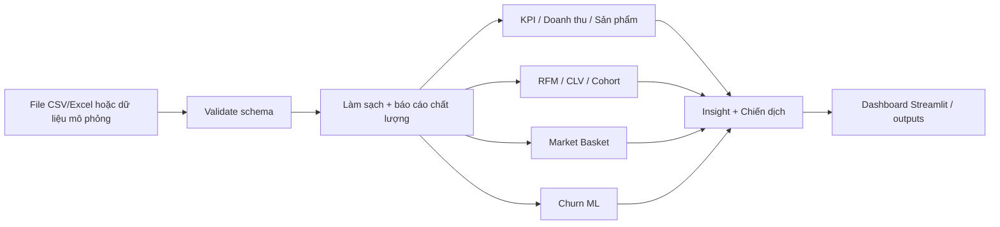

# USE CASE — Retail Analytics Intelligence

## Actors
- **Nhà phân tích (Analyst):** import dữ liệu, chạy phân tích, xem dashboard.
- **Quản lý kinh doanh (Manager):** xem KPI, insight, phân khúc, duyệt chiến dịch.
- **Hệ thống (Scheduler/CLI):** chạy `run_analysis.py` sinh báo cáo định kỳ.

## Use cases chính
| Mã | Tên | Luồng chính | Ngoại lệ |
|---|---|---|---|
| UC01 | Import & làm sạch dữ liệu | Chọn file → validate schema → làm sạch → xem báo cáo chất lượng | Thiếu cột → SchemaError nêu tên cột; file hỏng → thông báo không đọc được |
| UC02 | Xem KPI & doanh thu | Chọn lọc thời gian/khu vực/kênh → KPI + biểu đồ tháng/quý + tháng bất thường | Bộ lọc rỗng → cảnh báo, không crash |
| UC03 | Phân tích sản phẩm | Xem top SP theo doanh thu/số lượng/lợi nhuận + cơ cấu ngành hàng | — |
| UC04 | Phân khúc khách hàng | Tính RFM → bảng phân khúc + scatter + top CLV + cohort | Khách quá ít → quintile vẫn chạy nhờ rank(method='first') |
| UC05 | Phân tích giỏ hàng | Tính cặp SP → bảng support/confidence/lift → biểu đồ top lift | Không cặp nào đạt min count → bảng rỗng có thông báo |
| UC06 | Dự đoán rời bỏ | Chọn ngưỡng ngày → huấn luyện LR + RF → metrics → danh sách nguy cơ cao | Một lớp nhãn duy nhất → split stratify báo lỗi rõ (dữ liệu không đủ hai lớp) |
| UC07 | Insight & xuất báo cáo | Xem insight kèm số → tải CSV phân khúc/giỏ/risk → chạy CLI lấy report.md | — |

## Luồng tổng quát

